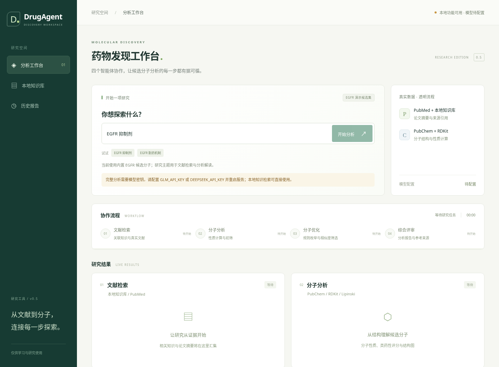

# DrugAgent · 多智能体药物发现平台

**从文献依据到分子优化，把每一步探索变成可追踪的研究结果。**

DrugAgent v0.5 将文献检索、分子分析、规则式类似物优化与综合评审连接成一个工作台。提供网页与命令行入口，支持实时进度、RDKit 结构图、本地知识检索及报告归档下载。

**Python 3.12 · FastAPI · RDKit · Docker Compose**

> v0.5 运行代码与完整部署资源位于 [`codex/platform-deployment-handoff`](https://github.com/liuhaolin07/drugagent/tree/codex/platform-deployment-handoff) 分支。请使用下方命令拉取该分支。

[快速开始](#快速开始) · [部署说明](docs/deployment.md) · [本地 Agent 交接](docs/LOCAL_AGENT_HANDOFF.md) · [验收记录](docs/deployment.md#验收记录) · [开发与 API](docs/development.md)



*实际工作台截图：未配置模型密钥时，页面说明可用能力与配置要求；本地知识检索仍可使用。*

## 能做什么

| 能力 | 结果 |
| --- | --- |
| 文献检索 | 本地语料与 PubMed 摘要检索，保留论文 PMID 和知识来源 |
| 分子分析 | 从 PubChem 获取 SMILES，用 RDKit 计算 MW、logP、TPSA、HBD、HBA、QED 与 Lipinski 判定 |
| 分子优化 | 15 种规则式修饰枚举类似物，按 Lipinski、相似度和 QED 筛选、排序 |
| 综合评审 | 模型解读已有证据，代码生成性质表、优化表与参考来源 |
| 研究工作台 | 四阶段实时进度、候选与类似物结构图、来源警告、Markdown 报告下载 |
| 一键交付 | 固定依赖与哈希校验、Docker 健康检查、非 root 运行、报告及缓存持久化 |

当前使用**内置 EGFR 演示候选集**。研究主题用于文献检索和解读，不会自动替换为其他靶点的候选分子。类似物来自 RDKit 规则式枚举，仍需实验与对接验证。

## 快速开始

需要已运行的 Docker Desktop，或 Docker Engine + Compose v2.20+。无需自行安装 Python、RDKit、Node.js、数据库或 GPU 环境。

```bash
git clone --branch codex/platform-deployment-handoff --single-branch https://github.com/liuhaolin07/drugagent.git
cd drugagent
docker compose up -d --build --wait --wait-timeout 120
```

默认在本机 `http://localhost:8077` 访问。首次会下载镜像和依赖，之后复用构建结果。

- **Windows**：进入项目后，也可直接双击 `start.bat`。
- **Linux / macOS**：也可执行 `sh scripts/start.sh`；Linux 已实测，macOS 尚未实测。
- **完整分析**：将 `.env.example` 复制为 `.env`，在本机编辑器中填写 `GLM_API_KEY` 或 `DEEPSEEK_API_KEY`，再重新执行启动命令。已有 `.env` 时保留其中配置；密钥不要提交到 Git。
- **无密钥体验**：本地 BM25 知识检索与按 SMILES 绘图可用；完整分析会明确提示模型待配置。
- **端口被占用**：在 `.env` 设置 `DRUGAGENT_PORT=8080`，重新启动后使用对应端口。

推荐由部署者统一配置模型并部署服务，让其他人打开网址使用。服务器、域名、HTTPS 与 SSE 反向代理步骤见 [部署说明](docs/deployment.md)。当前是共享研究工作区，访问者共用历史报告。

## 让本地 Agent 接手

把下面的任务交给本地 agent 即可。完整代码与部署资源都在 GitHub，不依赖云端附件：

```text
请拉取 liuhaolin07/drugagent 的 codex/platform-deployment-handoff 分支，
先阅读 docs/LOCAL_AGENT_HANDOFF.md，
按文档完成本机 Docker 部署、基础功能、真实在线分析及重启持久化验收。
保留已有配置，密钥仅使用本机环境变量或未跟踪的 .env，不要在聊天或日志中输出。
```

[Agent 交接清单](docs/LOCAL_AGENT_HANDOFF.md) 包含 Windows / Linux 命令、模型配置、验收标准、已知偏差与排错步骤。当前 v0.5 运行代码与部署资源位于 `codex/platform-deployment-handoff` 分支，本页提供统一入口。

## 工作流程


网页与 CLI 共用分析服务和报告存储。分子数据先计算，再交给模型解读；性质表、优化表和引用由代码生成。来源不可用时明确提示，所有候选分子均无法获取或流程未完成时不会发布成功报告。

## 验证情况

| 范围 | 验证结果 |
| --- | --- |
| Linux Docker | 完整构建、发布包全新目录启动、真实分子计算与 PNG、报告下载、重建后持久化通过 |
| 后端回归 | 云端 19 项测试通过，覆盖模型回退、SSE、CLI、真实 RDKit 与报告存储 |
| Windows Docker | 依据本地 agent 报告，`start.bat`、基础功能、4 次真实在线分析及重启持久化通过 |
| 浏览器 | 1440 / 390 宽度、阶段进度、结构图、安全 Markdown 渲染与失败恢复通过 |
| 待验证范围 | macOS、ARM、具体云平台与公网域名部署 |

Windows 在线验收取得真实 PubMed 论文和分子数据；示例 gefitinib 生成 55 个类似物，48 个通过筛选，展示 Top 6。验收基于提交 `fe41c77`；模型与网络可用性仍需在新部署机器上独立确认。详细来源与已知偏差见 [验收记录](docs/deployment.md#验收记录)。

## 文档与开发

| 入口 | 内容 |
| --- | --- |
| [部署说明](docs/deployment.md) | Docker、服务器与域名接入、数据持久化、更新与排错 |
| [Agent 交接](docs/LOCAL_AGENT_HANDOFF.md) | 从拉取仓库到完整验收的可执行清单 |
| [开发与 API 参考](docs/development.md) | Python 本地启动、配置变量、模块架构、接口与测试命令 |
| [.env.example](.env.example) | 模型、端口和存储路径配置模板 |
| [旧版报告示例](docs/example_report_EGFR.md) | 报告结构示例，非本次 Windows 验收产物 |

默认模型为 GLM，支持 DeepSeek 对话回退；语义检索不可用时使用 BM25。本地开发支持 `python web.py`、`python run.py "EGFR 抑制剂"`，详见开发文档。

项目使用 [MIT License](LICENSE)。仅供学习与研究，不构成医疗建议。
